  

  <b>YouTube research tools · reverse engineering · automation</b> 
  ships at night, fixes it by morning

  

---

<h3 align="center">Building</h3>

  

  <a href="https://github.com/ichigo212/nichescope"><b>Nichescope</b></a>: maps the channels around a YouTube channel, 
  spots the videos breaking out among them and suggests topics backed by them.

---

  [&nbsp;
  
  
  &nbsp;]

  

